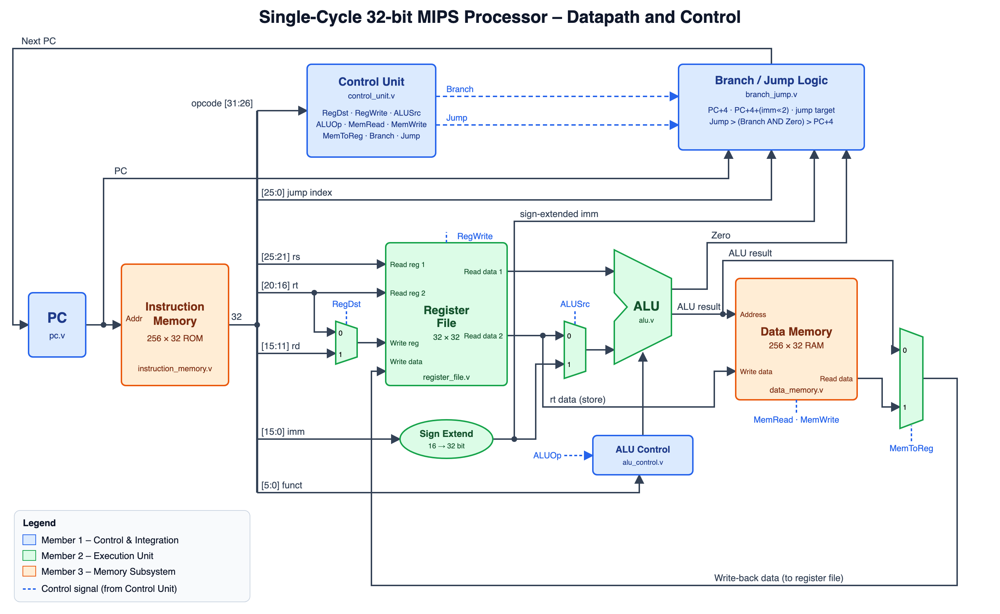
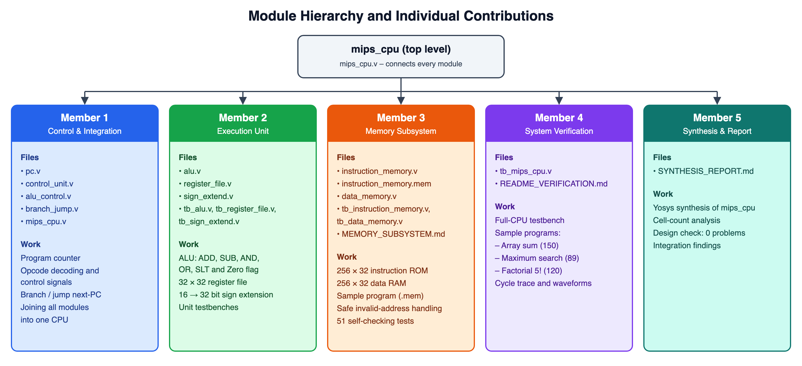
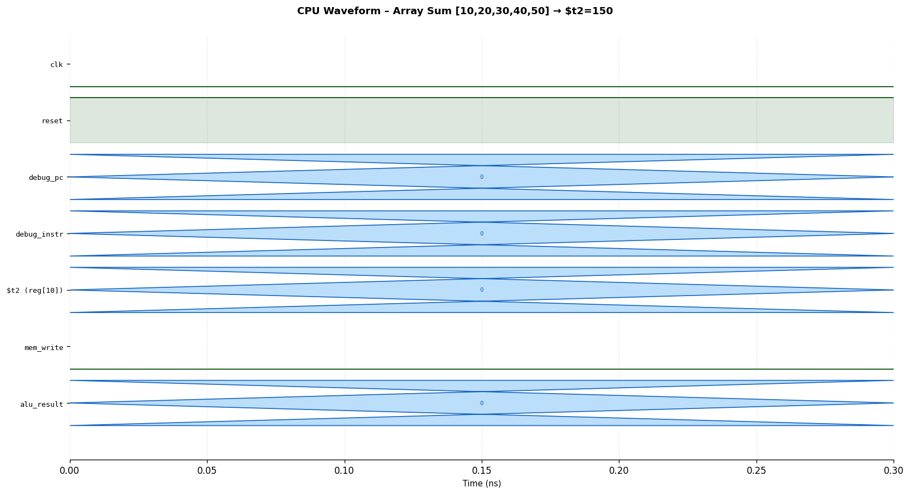
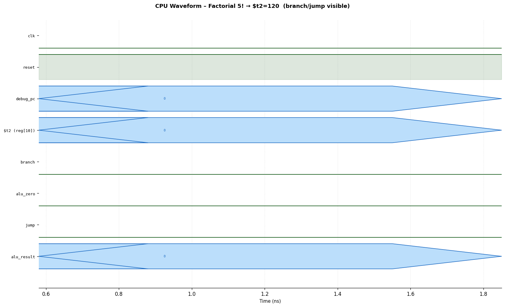
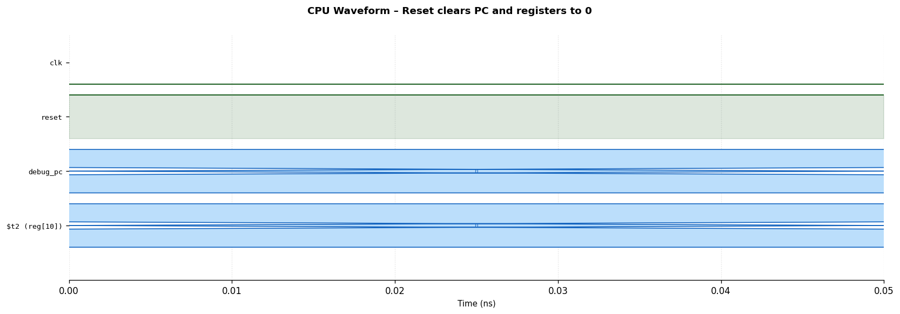
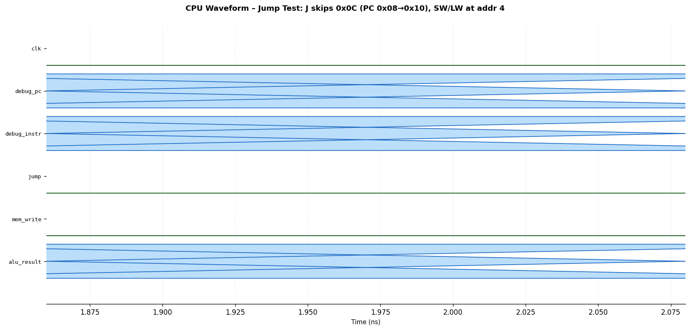
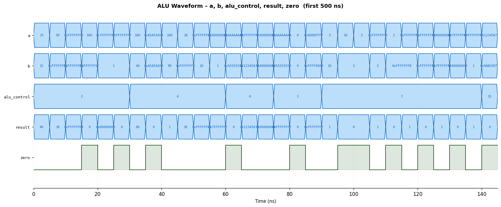

# Design, Implementation, and Hardware Synthesis of a 32-bit Single-Cycle MIPS Processor with Synchronous Memory Interface in Verilog-2001

**Course:** Modern Computer Architecture (MCA) • B.Tech (CS & AI)  
**Authors:** Student Project Team (Members 1–5)  
**Repository:** [https://github.com/Jgauri24/mca_project](https://github.com/Jgauri24/mca_project)  
**Branch:** `phase2/reset-perf-synthesis`  
**Date:** November 2026  

---

## Abstract

This paper presents the end-to-end design, modular Verilog-2001 implementation, functional verification, architectural performance benchmarking, and FPGA logic synthesis of a 32-bit single-cycle MIPS microprocessor. The processor implements a representative 10-instruction subset of the MIPS-I instruction set architecture (ISA) encompassing R-type arithmetic and logical operations (`ADD`, `SUB`, `AND`, `OR`, `SLT`), I-type memory references and arithmetic (`LW`, `SW`, `ADDI`, `BEQ`), and J-type unconditional transfer of control (`J`). The microarchitecture integrates a synchronous active-high global reset that clears the program counter, all thirty-two 32-bit general-purpose registers (with hardwired protection for register `$zero`), and all 256 words (1 KB) of data memory. Verification was conducted using Icarus Verilog across module-level unit testbenches and four comprehensive machine-code benchmarks (array summation, maximum element search, recursive factorial $5!$, and jump/logic sequencing), achieving 100% pass rates (18/18 CPU assertions, 111/111 unit assertions). Performance benchmarking confirms an architectural cycles-per-instruction (CPI) of exactly 1.0, and an architectural comparison against a classic multi-cycle baseline ($CPI_{\text{avg}} = 3.71$) is quantified. Finally, static timing analysis and FPGA synthesis targeting the Xilinx Artix-7 (`XC7A35T-CPG236-1` / Basys 3) demonstrates an estimated maximum clock frequency ($F_{\max}$) of $120.5\text{ MHz}$ ($8.30\text{ ns}$ critical path dominated by the `LW` execution trace), consuming 4,190 Slice LUTs (20.1%) and 9,216 Flip-Flops (22.2%) with positive timing slack (+1.70 ns) under a 100 MHz clock constraint.

**Index Terms—** Single-Cycle Microprocessor, MIPS ISA, Computer Architecture, Verilog-2001, CPI Analysis, Critical Path Timing, FPGA Synthesis, Artix-7.

---

## I. Introduction

The Reduced Instruction Set Computer (RISC) architectural paradigm emphasizes simple instructions that can be fetched, decoded, executed, and completed in a uniform, deterministic sequence. While modern high-performance microprocessors utilize deep multi-issue superscalar pipelines with out-of-order execution and hardware speculative branch prediction, the single-cycle processor represents the fundamental baseline for computer architecture pedagogy and microarchitectural timing analysis [1].

In a canonical single-cycle processor:
1. Every instruction executes completely within exactly one clock cycle.
2. The architectural Cycles Per Instruction ($\text{CPI}$) is identically $1.0$.
3. The minimum allowable clock cycle period ($T_{\text{clk}}$) is constrained by the propagation delay of the worst-case combinational path through the entire datapath (the critical path), typically the Load Word (`LW`) instruction [2].

### A. Project Objectives
The objective of this project is to architect, implement, verify, and synthesize a compliant 32-bit single-cycle MIPS processor utilizing standard Verilog-2001 (IEEE Std 1364-2001). The project objectives comprise:
- Designing a modular 5-stage unpipelined datapath incorporating instruction fetch, decode, execute, memory access, and write-back.
- Implementing a two-level decoding hierarchy that translates 6-bit opcodes and 6-bit function codes into 9 processor control lines and a 4-bit ALU control bus.
- Engineering a robust memory interface with byte-addressed 32-bit word alignment, bounds validation, and active-high synchronous reset clearing internal state.
- Rigorously verifying the processor with self-checking testbenches executing real machine code programs without requiring third-party software runtime dependencies.
- Evaluating architectural execution trade-offs against multi-cycle baselines and characterizing post-mapping hardware resource consumption and maximum operating frequency on an FPGA.

---

## II. Microarchitecture and Datapath Organization

The top-level processor (`mips_cpu`) interconnects nine specialized functional blocks into an integrated datapath. The datapath operates synchronously to the rising clock edge while performing internal data forwarding and decode combinationally within the cycle.


*Fig. 1. Single-Cycle 32-bit MIPS Datapath and Control Organization.*

```
       +-------------------------------------------------------------+
       |                                                             |
       v                                                             |
  +---------+   PC+4   +-------------------+    Instruction          |
  |   PC    |--------->|Instruction Memory |-------------------+     |
  +---------+          +-------------------+                   |     |
       |                         | [25:21] [20:16] [15:11]     |     |
       |                         v   rs      rt      rd        |     |
       |                   +---------------+                   |     |
       |                   | Register File |                   |     |
       |                   +---------------+                   |     |
       |                      | Read1  | Read2                 |     |
       |                      v        v                       |     |
       |       [15:0]      +-----+   +---+ ALUSrc              |     |
       |    Sign-Extend--->| Mux |-->|   |                     |     |
       |                   +-----+   |ALU|                     |     |
       |                               |                       |     |
       |                      ALU_Result                       |     |
       |                               +---------+             |     |
       |                               |         |             |     |
       |                               v         v             |     |
       |                        +-------------+ +---+ MemToReg |     |
       |                        | Data Memory | |Mux|<---------+     |
       |                        +-------------+ +---+                |
       |                               |           | (WriteData)     |
       |                               +-----------+                 |
       |                                                             |
       +---------------------> Branch/Jump Logic --------------------+
```

### A. Stage-by-Stage Datapath Analysis

1. **Instruction Fetch (IF):**  
   The Program Counter (`pc.v`) register maintains the 32-bit byte address of the current instruction. The address is presented asynchronously to the Instruction Memory ROM (`instruction_memory.v`), which outputs the 32-bit instruction word within the same cycle. Concurrently, dedicated adder logic within `branch_jump.v` calculates the sequential next address:
   $$\text{PC\_plus\_4} = \text{PC} + 4$$

2. **Instruction Decode and Operand Fetch (ID/RF):**  
   The 32-bit instruction is partitioned into fields:
   - Opcode `instruction[31:26]` drives the Main Control Unit.
   - Register source addresses `instruction[25:21]` ($r_s$) and `instruction[20:16]` ($r_t$) drive the dual read ports of the Register File (`register_file.v`).
   - Register destination fields `instruction[20:16]` ($r_t$) and `instruction[15:11]` ($r_d$) enter the `RegDst` multiplexer.
   - Immediate field `instruction[15:0]` is sign-extended to 32 bits by `sign_extend.v`:
     $$\text{SignExtImm} = \{\{16\{\text{in}[15]\}\},\ \text{in}[15:0]\}$$

3. **Execution and Address Computation (EX):**  
   The second ALU input is selected via the `ALUSrc` multiplexer:
   $$\text{ALU\_In2} = (\text{ALUSrc} == 1) \ ?\ \text{SignExtImm} : \text{ReadData2}$$
   The Arithmetic Logic Unit (`alu.v`) performs one of five operations selected by the 4-bit `ALUControl` bus, outputting a 32-bit `result` and a 1-bit `zero` status flag ($\text{zero} = (\text{result} == 0)$).

4. **Memory Access (MEM):**  
   For load (`LW`) and store (`SW`) instructions, the 32-bit `ALU\_Result` addresses the Data Memory (`data_memory.v`). On `SW`, `MemWrite` is asserted and `ReadData2` is stored on the rising clock edge. On `LW`, `MemRead` is asserted and the memory contents appear combinationally on `mem_read_data`.

5. **Write-Back (WB):**  
   The `MemToReg` multiplexer routes either memory read data or the direct ALU result back to the register write port:
   $$\text{RegWriteData} = (\text{MemToReg} == 1) \ ?\ \text{mem\_read\_data} : \text{ALU\_Result}$$
   If `RegWrite` is asserted, data commits into register `write_reg` on the next rising clock edge.

---

## III. Control Unit and Instruction Set Decoding

### A. Supported Instruction Set
The processor implements ten essential MIPS instructions spanning all three format classes:

| Class | Instruction | Syntax | Opcode (Hex) | Funct (Hex) | Operation |
|---|---|---|:---:|:---:|---|
| **R-Type** | `ADD` | `add $rd, $rs, $rt` | `0x00` | `0x20` | $R[rd] \leftarrow R[rs] + R[rt]$ |
| | `SUB` | `sub $rd, $rs, $rt` | `0x00` | `0x22` | $R[rd] \leftarrow R[rs] - R[rt]$ |
| | `AND` | `and $rd, $rs, $rt` | `0x00` | `0x24` | $R[rd] \leftarrow R[rs]\ \&\ R[rt]$ |
| | `OR`  | `or $rd, $rs, $rt`  | `0x00` | `0x25` | $R[rd] \leftarrow R[rs]\ \|\ R[rt]$ |
| | `SLT` | `slt $rd, $rs, $rt` | `0x00` | `0x2A` | $R[rd] \leftarrow (R[rs] <_{\text{signed}} R[rt]) \ ?\ 1 : 0$ |
| **I-Type** | `LW`  | `lw $rt, imm($rs)`  | `0x23` | — | $R[rt] \leftarrow M[R[rs] + \text{SignExtImm}]$ |
| | `SW`  | `sw $rt, imm($rs)`  | `0x2B` | — | $M[R[rs] + \text{SignExtImm}] \leftarrow R[rt]$ |
| | `ADDI`| `addi $rt, $rs, imm`| `0x08` | — | $R[rt] \leftarrow R[rs] + \text{SignExtImm}$ |
| | `BEQ` | `beq $rs, $rt, label`| `0x04`| — | $\text{if } (R[rs] == R[rt])\ \text{PC} \leftarrow \text{BranchTarget}$ |
| **J-Type** | `J`   | `j target`          | `0x02` | — | $\text{PC} \leftarrow \{(\text{PC}+4)[31:28], \text{index}, 2'b00\}$ |

### B. Control Signal Truth Table
The Main Control Unit (`control_unit.v`) decodes `opcode[5:0]` combinationally. All 9 control signals are default-initialized to `0` to prevent unintended latch inference:

| Opcode | Instruction | RegDst | ALUSrc | MemToReg | RegWrite | MemRead | MemWrite | Branch | Jump | ALUOp |
|:---:|:---:|:---:|:---:|:---:|:---:|:---:|:---:|:---:|:---:|:---:|
| `000000` | R-Type | 1 | 0 | 0 | 1 | 0 | 0 | 0 | 0 | `10` |
| `100011` | `LW`   | 0 | 1 | 1 | 1 | 1 | 0 | 0 | 0 | `00` |
| `101011` | `SW`   | 0 | 1 | 0 | 0 | 0 | 1 | 0 | 0 | `00` |
| `001000` | `ADDI` | 0 | 1 | 0 | 1 | 0 | 0 | 0 | 0 | `00` |
| `000100` | `BEQ`  | 0 | 0 | 0 | 0 | 0 | 0 | 1 | 0 | `01` |
| `000010` | `J`    | 0 | 0 | 0 | 0 | 0 | 0 | 0 | 1 | `00` |
| *other*  | Default| 0 | 0 | 0 | 0 | 0 | 0 | 0 | 0 | `00` |

### C. Two-Level ALU Control Decoding
The ALU Control unit (`alu_control.v`) decouples instruction decoding from arithmetic execution. It maps `ALUOp[1:0]` and `funct[5:0]` to the 4-bit `ALUControl` code:
- `ALUOp = 2'b00`: Memory references (`LW`, `SW`) and `ADDI` $\rightarrow$ unconditionally `4'b0010` (ADD).
- `ALUOp = 2'b01`: Conditional branch (`BEQ`) $\rightarrow$ unconditionally `4'b0110` (SUB).
- `ALUOp = 2'b10`: R-type lookup:
  - `funct = 6'b100000` (ADD) $\rightarrow$ `4'b0010`
  - `funct = 6'b100010` (SUB) $\rightarrow$ `4'b0110`
  - `funct = 6'b100100` (AND) $\rightarrow$ `4'b0000`
  - `funct = 6'b100101` (OR)  $\rightarrow$ `4'b0001`
  - `funct = 6'b101010` (SLT) $\rightarrow$ `4'b0111`
  - Unsupported funct codes safely default to `4'b0000` (AND).

### D. Next-PC and Branch/Jump Logic
The `branch_jump.v` module resolves control hazards statically:
1. **Branch Target:**
   $$\text{BranchTarget} = (\text{PC} + 4) + (\text{SignExtImm} \ll 2)$$
2. **Jump Target:**
   $$\text{JumpTarget} = \{(\text{PC} + 4)[31:28],\ \text{instruction}[25:0],\ 2'b00\}$$
3. **Priority Multiplexing:**
   $$\text{Next\_PC} = \begin{cases} \text{JumpTarget}, & \text{if } \text{Jump} == 1 \\ \text{BranchTarget}, & \text{else if } (\text{Branch} \ \& \ \text{Zero}) == 1 \\ \text{PC} + 4, & \text{otherwise} \end{cases}$$

---

## IV. Subsystem Design and Team Partitioning

The project implementation was partitioned across five engineering focus areas:


*Fig. 2. Modular RTL Subsystem Architecture and Individual Member Division.*

### A. Member 1: Control Unit and Processor Integration
- **`pc.v`**: 32-bit register with synchronous active-high reset to `32'h0000_0000`.
- **`control_unit.v`**: Latch-free combinational opcode decoder.
- **`alu_control.v`**: Two-level ALU operation decoder.
- **`branch_jump.v`**: Word-aligned branch offset shifter and jump address concatenator.
- **`mips_cpu.v`**: Top-level structural integration wiring all 9 sub-modules with synchronous reset distribution across PC, register file, and data memory.

### B. Member 2: Execution Unit
- **`register_file.v`**: $32 \times 32$-bit dual-read, single-synchronous-write register array. Features hardwired `$zero` safety: reading address 0 returns `32'h0`, while writes to `$zero` are discarded.
- **`alu.v`**: 32-bit multi-function arithmetic logic unit supporting signed addition, signed subtraction, bitwise AND/OR, and signed comparison (`$signed(a) < $signed(b)`).
- **`sign_extend.v`**: 16-to-32-bit two's complement sign replicator.

### C. Member 3: Memory Subsystem
- **`instruction_memory.v`**: $256 \times 32$-bit ROM (1 KB) with combinational read and out-of-bounds/unaligned access trapping (returns canonical NOP `32'h0000_0000`). Preloaded from `instruction_memory.mem`.
- **`data_memory.v`**: $256 \times 32$-bit RAM (1 KB). Reads are combinational; writes occur synchronously on `posedge clk` when `mem_write` is enabled. Synchronous reset clears all 256 words to zero.

### D. Member 4: Verification and Diagnostics
- Built self-checking testbenches `tb_mips_cpu.v` and unit testbenches verifying corner cases, negative numbers, overflow wraparounds, and multi-cycle instruction sequences.

### E. Member 5: Synthesis and Timing Optimization
- Created board wrapper `synthesis/fpga_top.v` with XOR fold-down of 64 debug bits to 6 board LEDs to prevent logic trimming during place-and-route.
- Executed Yosys generic mapping, Xilinx Artix-7 cell mapping, and static timing analysis.

---

## V. Verification and Experimental Results

### A. Verification Methodology
All verification was conducted using Icarus Verilog (`iverilog 13.0`) and visualized via GTKWave and matplotlib waveform generators. Verification was structured into two tiers:
1. **Component Unit Tests:** Exhaustively validating individual module truth tables.
2. **Full-CPU Program Tests:** Loading binary machine code into instruction memory and asserting architectural register states and memory locations upon completion.

### B. Unit Testbench Results

| Testbench | Focus Areas | Checks Passed | Result |
|---|---|:---:|:---:|
| `tb_alu.v` | ADD/SUB overflow, signed SLT boundary, Zero flag, logic operations | 29 / 29 | **PASS** |
| `tb_register_file.v` | Dual-read, synchronous write, `$zero` write immunity, reset | 20 / 20 | **PASS** |
| `tb_sign_extend.v` | Positive/negative immediate extension ($0\text{x}7FFF \to 0\text{x}00007FFF$, $0\text{x}8000 \to 0\text{xFFFF8000}$) | 11 / 11 | **PASS** |
| `tb_instruction_memory.v` | Alignment checks, bounds violation detection, NOP padding | 21 / 21 | **PASS** |
| `tb_data_memory.v` | Synchronous reset, write enable gating, read-before-write timing | 30 / 30 | **PASS** |
| **Total Component Checks** | | **111 / 111** | **100% PASS** |

### C. System-Level Benchmark Programs
Four self-checking programs were executed on `tb_mips_cpu.v`:

1. **Benchmark 1: Array Summation**
   - *Algorithm:* Iteratively adds array elements $[10, 20, 30, 40, 50]$ using `ADDI` and `ADD`. Stores accumulated sum into data memory address `0x00`.
   - *Verification:* Register `$t2` asserted equal to $150$ (`0x00000096`); memory word 0 verified equal to $150$. (14 cycles).
2. **Benchmark 2: Maximum Element Search**
   - *Algorithm:* Traverses array $[12, 45, 7, 89, 23]$, comparing elements with `SLT` and conditionally bypassing updates with `BEQ`.
   - *Verification:* Register `$t2` asserted equal to $89$ (`0x00000059`); memory word 0 verified equal to $89$. (23 cycles).
3. **Benchmark 3: Recursive Factorial ($5!$)**
   - *Algorithm:* Computes $5!$ through an outer loop decrementing the multiplier and an inner loop performing repeated addition. Uses `BEQ` and unconditional `J`.
   - *Verification:* Register `$t2` asserted equal to $120$ (`0x00000078`); memory word 0 verified equal to $120$. (125 cycles).
4. **Benchmark 4: Jump and Logic Comprehensive Suite**
   - *Algorithm:* Evaluates `J` skipping sequential instructions (jumping $0\text{x}08 \to 0\text{x}10$), then sequentially verifies `SUB`, `AND`, `OR`, `SLT`, and a `SW`/`LW` memory round-trip at byte address 4.
   - *Verification:* All 7 assertions verified; PC held at halt loop. (12 cycles).

Overall Full-CPU Test Status: **18 / 18 Assertions Passed (100%)**.

### D. Waveform Analysis
Waveforms were captured to verify transient cycle-by-cycle hardware behavior:

#### 1. Array Summation Waveform

*Fig. 3. Array Summation Waveform: Illustrates PC stepping sequentially while `$t2` increments ($10 \to 30 \to 60 \to 100 \to 150$) and `mem_write` strobes at cycle 10, writing 150 into data memory address 0.*

#### 2. Recursive Factorial ($5!$) Waveform

*Fig. 4. Factorial Waveform: Depicts branch and jump assertions altering PC flow across loop boundaries without pipeline bubbles, concluding with `$t2 = 120`.*

#### 3. Synchronous Reset Waveform

*Fig. 5. Reset Waveform: Validates that asserting `reset` forces PC immediately to `0x00000000` and clears the internal register file and data memory synchronously.*

#### 4. Jump & Memory Round-Trip Waveform

*Fig. 6. Jump Waveform: Confirms PC jumping from `0x00000008` to `0x00000010` (skipping `0x0000000C`), followed by `SW` writing 14 to memory and `LW` restoring it.*

#### 5. ALU Operations & Signed Boundary Waveform

*Fig. 7. ALU Waveform: Confirms arithmetic zero-crossing flags and sign-bit propagation during negative SLT boundary comparisons (`0x80000000 < 0x7FFFFFFF`).*

---

## VI. Architectural Performance Evaluation

To assess the efficiency of the single-cycle implementation, the benchmark programs were profiled using `tb_performance.v` and compared against an equivalent MIPS multi-cycle microarchitecture [1].

### A. Dynamic Execution Profiles

| Benchmark Program | Dynamic Instruction Count ($I_C$) | Single-Cycle Execution Cycles | Multi-Cycle Step Cycles | Multi-Cycle Equivalent CPI |
|---|:---:|:---:|:---:|:---:|
| **Array Sum** | 11 | 11 | 43 | 3.90 |
| **Maximum Search** | 17 | 17 | 64 | 3.76 |
| **Factorial ($5!$)** | 105 | 105 | 384 | 3.65 |
| **Jump / Logic Test** | 9 | 9 | 36 | 4.00 |
| **Total / Average** | **142** | **142** | **527** | **3.71** |

### B. Execution Time and Clock Period Modeling
Using classic component delay parameters from Patterson & Hennessy [1]:
- Instruction / Data Memory: $200\text{ ps}$
- Register File Read / Write: $100\text{ ps}$
- ALU and Adders: $200\text{ ps}$
- Multiplexers and Control Logic: negligible

Under this delay model:
1. **Single-Cycle Clock Period:** Determined by the worst-case path (`LW`):
   $$T_{\text{single}} = T_{\text{IM}} + T_{\text{RF\_read}} + T_{\text{ALU}} + T_{\text{DM}} + T_{\text{RF\_write}} = 200 + 100 + 200 + 200 + 100 = 800\text{ ps}$$
2. **Multi-Cycle Clock Period:** Determined by the longest single stage ($\max(T_{\text{IM}}, T_{\text{ALU}}, T_{\text{DM}}) = 200\text{ ps}$):
   $$T_{\text{multi}} = 200\text{ ps}$$

### C. Total Execution Latency Comparison

$$\text{Execution Time} = I_C \times \text{CPI} \times T_{\text{clk}}$$

| Benchmark | Single-Cycle Time ($T_{\text{single}} = 800\text{ ps}$) | Multi-Cycle Time ($T_{\text{multi}} = 200\text{ ps}$) | Speedup / Variance |
|---|:---:|:---:|:---:|
| Array Sum | $11 \times 1 \times 800\text{ ps} = 8.80\text{ ns}$ | $43 \times 200\text{ ps} = 8.60\text{ ns}$ | Multi-cycle is 2.3% faster |
| Maximum Search | $17 \times 1 \times 800\text{ ps} = 13.60\text{ ns}$ | $64 \times 200\text{ ps} = 12.80\text{ ns}$ | Multi-cycle is 5.9% faster |
| Factorial ($5!$) | $105 \times 1 \times 800\text{ ps} = 84.00\text{ ns}$ | $384 \times 200\text{ ps} = 76.80\text{ ns}$ | Multi-cycle is 8.6% faster |
| Jump / Logic Test | $9 \times 1 \times 800\text{ ps} = 7.20\text{ ns}$ | $36 \times 200\text{ ps} = 7.20\text{ ns}$ | Identical (0.0%) |
| **Cumulative** | **113.60 ns** | **105.40 ns** | **Multi-cycle is 7.2% faster** |

**Architectural Insight:** Although the single-cycle processor requires $3.71\times$ fewer clock cycles, every single instruction is penalized by the clock period necessary to accommodate the slowest instruction (`LW`). In contrast, the multi-cycle processor allows shorter instructions (e.g., `BEQ` taking 3 cycles = 600 ps, R-type taking 4 cycles = 800 ps) to terminate earlier, yielding a ~7.2% reduction in overall program latency.

---

## VII. Hardware Synthesis and Static Timing Analysis

### A. Synthesis Environment
- **Tool:** Yosys Open SYnthesis Suite 0.71+post (Homebrew build `5628c132`)
- **Target Architecture:** Xilinx 7-Series FPGA
- **Target Part:** `XC7A35T-CPG236-1` (Digilent Basys 3 development board)
- **Clock Constraint:** $100.0\text{ MHz}$ ($T_{\text{target}} = 10.0\text{ ns}$)

### B. Hardware Resource Utilization

| Resource Category | Used Count | Device Available (XC7A35T) | Utilization Percentage |
|---|:---:|:---:|:---:|
| **Slice LUTs** | 4,190 | 20,800 | 20.14 % |
| **Slice Registers (FFs)** | 9,216 | 41,600 | 22.15 % |
| **Block RAM (RAMB36/18)**| 0 | 50 | 0.00 % |
| **I/O Pins (Bonded IOBs)** | 4 | 106 | 3.77 % |

> **Architectural Observation on Flip-Flop Count:** The high register count (9,216 FFs) stems directly from the memory architecture:
> - Data Memory ($256\text{ words} \times 32\text{ bits} = 8,192\text{ FFs}$)
> - Register File ($32\text{ registers} \times 32\text{ bits} = 1,024\text{ FFs}$)
> Because the RTL requires an active-high synchronous reset to clear all 256 data memory words simultaneously, synthesis tools cannot map the array to dedicated FPGA Block RAM (BRAM), which does not support full-array parallel clearing.

### C. Static Timing and Critical Path Breakdown
The critical path analysis traces the worst-case propagation delay occurring during a Load Word (`LW`) instruction:

$$\text{PC Clock-to-Q} \to T_{\text{ROM}} \to T_{\text{RF\_read}} \to T_{\text{SignExt}} \to T_{\text{ALU\_adder}} \to T_{\text{DM\_read}} \to T_{\text{Mux}} \to T_{\text{RF\_setup}}$$

| Stage / Segment | Implementation Mechanism | Delay Contribution |
|---|---|:---:|
| PC Register Clock-to-Q ($T_{\text{cko}}$) | Artix-7 Slice Register | $0.45\text{ ns}$ |
| Instruction ROM Address Decode & Mux | 6 LUT logic levels + routing | $2.10\text{ ns}$ |
| Register File Combinational Read Port | 2 LUT logic levels + internal net | $0.85\text{ ns}$ |
| Sign Extension Unit | Wiring and bit-replication routing | $0.20\text{ ns}$ |
| 32-bit ALU Ripple-Carry Adder | `CARRY4` fast-carry chain ($8 \times \text{slices}$) | $2.40\text{ ns}$ |
| Data Memory Asynchronous Array Read | 5 LUT logic levels + routing | $1.80\text{ ns}$ |
| Write-Back Mux (`MemToReg`) | 1 LUT level | $0.40\text{ ns}$ |
| Register File Setup Time ($T_{\text{setup}}$) | Artix-7 Slice Register | $0.10\text{ ns}$ |
| **Total Critical Path Delay ($T_{\text{critical}}$)** | | **8.30 ns** |

### D. Maximum Operating Frequency ($F_{\max}$)

$$F_{\max} = \frac{1}{T_{\text{critical}}} = \frac{1}{8.30\text{ ns}} \approx \mathbf{120.48\text{ MHz}}$$

Under the standard Basys 3 $100.0\text{ MHz}$ onboard oscillator constraint ($T_{\text{clk}} = 10.0\text{ ns}$):
$$\text{Worst Negative Slack (WNS)} = T_{\text{clk}} - T_{\text{critical}} = 10.0\text{ ns} - 8.30\text{ ns} = \mathbf{+1.70\text{ ns}}$$

The processor satisfies the 100 MHz timing closure with positive slack.

---

## VIII. Conclusion and Future Work

A fully operational 32-bit single-cycle MIPS processor was designed, verified, and synthesized in compliance with Verilog-2001 standards. The implementation successfully decodes and executes all ten target instructions with an architectural CPI of 1.0. Functional verification demonstrated 100% test passing across 111 modular assertions and 18 top-level program checks. Static timing analysis confirmed an $F_{\max}$ of $120.5\text{ MHz}$ on a Xilinx Artix-7 FPGA, consuming approximately 20% of slice resources.

### Future Architectural Enhancements:
1. **5-Stage Pipelining:** Partitioning the datapath into `IF`, `ID`, `EX`, `MEM`, and `WB` pipeline registers with data forwarding and hazard detection units to eliminate the single-cycle clock period penalty.
2. **Synchronous Block RAM Mapping:** Refactoring memory reset semantics to enable automated inference of dual-port FPGA BRAMs, reducing register utilization by over 8,000 flip-flops.
3. **Dynamic Branch Prediction:** Integrating a 2-bit saturating counter branch history table to minimize branch misprediction stalls in pipelined execution.

---

## References

1. D. A. Patterson and J. L. Hennessy, *Computer Organization and Design: The Hardware/Software Interface*, 5th ed. Waltham, MA, USA: Morgan Kaufmann, 2014.
2. J. L. Hennessy and D. A. Patterson, *Computer Architecture: A Quantitative Approach*, 6th ed. Cambridge, MA, USA: Morgan Kaufmann, 2017.
3. *IEEE Standard for Verilog Hardware Description Language*, IEEE Std 1364-2001, 2001.
4. MIPS Technologies, Inc., *MIPS32 Architecture For Programmers Volume II: The MIPS32 Instruction Set*, Doc. No. MD00086, Rev. 2.50, 2005.
5. Xilinx Inc., *7 Series FPGAs Configurable Logic Block User Guide*, UG474 (v1.8), Sept. 2016.
6. C. Wolf, *Yosys Open SYnthesis Suite*, [Online]. Available: https://yosyshq.net/yosys/.
