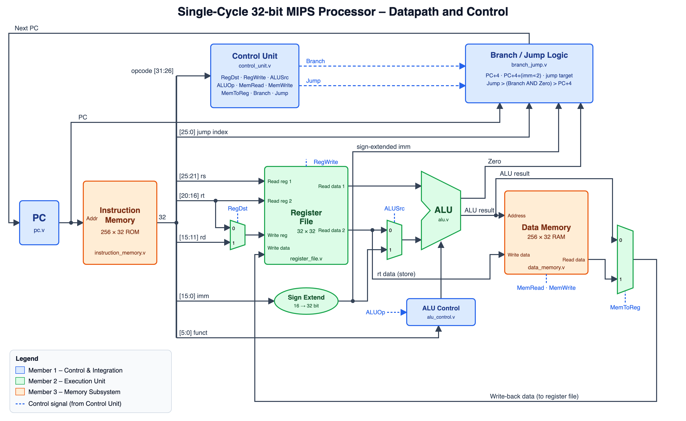

# Single-Cycle 32-bit MIPS Processor with Memory Interface

A 32-bit single-cycle MIPS processor written in Verilog-2001. Every instruction is fetched, decoded, executed and written back in one clock cycle. The processor supports arithmetic, logic, memory and branch/jump instructions. It runs four sample programs: array sum, maximum search, factorial and a jump/logic test.

> 🎥 **Phase I Prototype Demo Video:** [Watch on Google Drive](https://drive.google.com/file/d/14KFQ28BnsEGIQnmpHRSVrq3OwRP9Rdy6/view?usp=sharing)



---

## Features

- **Instruction set:** `add`, `sub`, `and`, `or`, `slt`, `lw`, `sw`, `addi`, `beq`, `j`
- **Datapath:** PC, instruction memory, register file (32 × 32), sign extension, ALU, data memory, branch/jump logic and write-back multiplexer
- **Memories:** 256 × 32-bit instruction ROM and 256 × 32-bit data RAM (1 KB each) with safe handling of invalid addresses
- **Reset:** one active-high synchronous reset clears the PC, all 32 registers and all 256 data-memory words
- **Verification:** self-checking testbenches for every module plus full-CPU program tests and reset checks
- **Performance:** dynamic instruction mix, cycles and CPI measured in simulation and compared with a multi-cycle baseline
- **Synthesis:** Yosys generic, Xilinx Artix-7 and Gowin place-and-route results with maximum frequency (scripts in `synthesis/`)

---

## Project Structure

| Module | File | Description |
|---|---|---|
| Top level | `mips_cpu.v` | Connects all modules into the single-cycle CPU |
| Program Counter | `pc.v` | 32-bit PC register with synchronous reset |
| Control Unit | `control_unit.v` | Decodes the opcode into control signals |
| ALU Control | `alu_control.v` | Chooses the ALU operation from ALUOp and funct |
| Branch / Jump | `branch_jump.v` | Calculates PC+4, branch target and jump target |
| Register File | `register_file.v` | 32 registers, two read ports and one write port |
| Sign Extension | `sign_extend.v` | Extends a 16-bit immediate to 32 bits |
| ALU | `alu.v` | ADD, SUB, AND, OR, SLT and Zero flag |
| Instruction Memory | `instruction_memory.v` | 256 × 32 ROM loaded from `instruction_memory.mem` |
| Data Memory | `data_memory.v` | 256 × 32 RAM used by `lw` and `sw` |

| Testbench | What it checks |
|---|---|
| `tb_alu.v` | All ALU operations, Zero flag, signed SLT, overflow |
| `tb_register_file.v` | Reads, writes, reset, `$zero` protection |
| `tb_sign_extend.v` | Positive and negative immediates |
| `tb_instruction_memory.v` | Fetching, program loading, invalid and unaligned addresses |
| `tb_data_memory.v` | Read/write, reset, invalid addresses, read and write in the same cycle |
| `tb_mips_cpu.v` | Full CPU running array sum, maximum search, factorial and a jump/logic test; checks reset |
| `tb_performance.v` | Instruction mix, cycles and CPI for every program; single-cycle vs multi-cycle comparison |

Other documents: [MEMORY_SUBSYSTEM.md](MEMORY_SUBSYSTEM.md), [README_VERIFICATION.md](README_VERIFICATION.md), [SYNTHESIS_REPORT.md](SYNTHESIS_REPORT.md)

---

## Team and Individual Contributions

| Member | Area | Main files |
|---|---|---|
| Member 1 | Control Unit & Processor Integration | `pc.v`, `control_unit.v`, `alu_control.v`, `branch_jump.v`, `mips_cpu.v` |
| Member 2 | Execution Unit | `alu.v`, `register_file.v`, `sign_extend.v` and their testbenches |
| Member 3 | Memory Subsystem | `instruction_memory.v`, `instruction_memory.mem`, `data_memory.v` and their testbenches |
| Member 4 | System Verification | `tb_mips_cpu.v`, `README_VERIFICATION.md` |
| Member 5 | Synthesis | `SYNTHESIS_REPORT.md`, `synthesis/` |


---

## How to Run

Requirement: [Icarus Verilog](https://steveicarus.github.io/iverilog/) (`brew install icarus-verilog` on macOS, `sudo apt install iverilog` on Ubuntu).

Run these commands from the project folder.

**Full CPU (array sum, maximum, factorial)**
```bash
iverilog -g2001 -o sim_cpu mips_cpu.v pc.v instruction_memory.v control_unit.v register_file.v sign_extend.v alu_control.v alu.v data_memory.v branch_jump.v tb_mips_cpu.v
vvp sim_cpu
```

**Performance measurement (cycles, CPI, multi-cycle comparison)**
```bash
iverilog -g2001 -o sim_perf mips_cpu.v pc.v instruction_memory.v control_unit.v register_file.v sign_extend.v alu_control.v alu.v data_memory.v branch_jump.v tb_performance.v
vvp sim_perf
```

**Individual modules**
```bash
iverilog -g2001 -o sim_alu alu.v tb_alu.v && vvp sim_alu
iverilog -g2001 -o sim_rf register_file.v tb_register_file.v && vvp sim_rf
iverilog -g2001 -o sim_se sign_extend.v tb_sign_extend.v && vvp sim_se
iverilog -g2001 -o sim_imem instruction_memory.v tb_instruction_memory.v && vvp sim_imem
iverilog -g2001 -o sim_dmem data_memory.v tb_data_memory.v && vvp sim_dmem
```

Each testbench prints a `[PASS]` or `[FAIL]` line for every check and a final summary. VCD waveform files are created and can be opened in GTKWave.

---

## Results

| Testbench | Checks passed |
|---|---|
| ALU | 29 / 29 |
| Register File | 20 / 20 |
| Sign Extension | 11 / 11 |
| Instruction Memory | 21 / 21 |
| Data Memory | 30 / 30 |
| Full CPU (4 programs + reset) | 18 / 18 |
| Performance runs | 4 / 4 programs correct |

| Program | Expected result | Result |
|---|---|---|
| Array sum of [10, 20, 30, 40, 50] | 150 | 150 ✔ |
| Maximum of [12, 45, 7, 89, 23] | 89 | 89 ✔ |
| Factorial 5! | 120 | 120 ✔ |
| Jump/logic test (J skips an `addi`, then SUB/AND/OR/SLT/SW/LW) | 2, 8, 14, 1, 14, 14 | all ✔ |

### Performance

Measured with `tb_performance.v` (each program runs until its halt loop; the halt jump is not counted). The single-cycle CPU always has **CPI = 1**. The multi-cycle column uses the classic multi-cycle MIPS step counts (R-type 4, ADDI 4, LW 5, SW 4, BEQ 3, J 3). Times use the textbook component delays (memory 200 ps, register read 100 ps, ALU 200 ps, register write 100 ps), which give an 800 ps single-cycle clock and a 200 ps multi-cycle clock.

| Program | Instructions | Single-cycle cycles | Multi-cycle cycles | Multi-cycle CPI | Single-cycle time | Multi-cycle time |
|---|---:|---:|---:|---:|---:|---:|
| Array sum | 11 | 11 | 43 | 3.90 | 8.8 ns | 8.6 ns |
| Maximum search | 17 | 17 | 64 | 3.76 | 13.6 ns | 12.8 ns |
| Factorial 5! | 105 | 105 | 384 | 3.65 | 84.0 ns | 76.8 ns |
| Jump/logic test | 9 | 9 | 36 | 4.00 | 7.2 ns | 7.2 ns |
| **Total** | **142** | **142** | **527** | **3.71** | **113.6 ns** | **105.4 ns** |

The single-cycle design needs 3.7x fewer cycles, but every cycle must be long enough for the slowest instruction (LW). With these delays the multi-cycle baseline takes about 7% less total time (105.4 ns vs 113.6 ns), because most instructions are R-type, ADDI and BEQ, which finish in 3-4 short steps.

Synthesis: Yosys generic 22,625 cells (0 problems); Xilinx Artix-7 estimate 4,190 LUTs and 9,216 flip-flops (about 20 % of a Basys3). Place-and-route and maximum frequency are in [SYNTHESIS_REPORT.md](SYNTHESIS_REPORT.md).

---

## Diagrams

| Diagram | File |
|---|---|
| Datapath and control | [01_datapath.png](diagrams/01_datapath.png) |
| Module hierarchy and contributions | [02_team_modules.png](diagrams/02_team_modules.png) |
| Instruction formats | [03_instruction_formats.png](diagrams/03_instruction_formats.png) |
| Single-cycle execution flow | [04_execution_flow.png](diagrams/04_execution_flow.png) |
| Control signal truth table | [05_control_signals.png](diagrams/05_control_signals.png) |
| Memory subsystem | [06_memory_subsystem.png](diagrams/06_memory_subsystem.png) |
| Verification and synthesis flow | [07_verification_flow.png](diagrams/07_verification_flow.png) |

Editable SVG versions of every diagram are in the same folder.

---

## Project Deliverables

- **Project report (IEEE format):** to be added
- **Prototype video:** [Google Drive - Phase I Prototype Demonstration Video](https://drive.google.com/file/d/14KFQ28BnsEGIQnmpHRSVrq3OwRP9Rdy6/view?usp=sharing)
