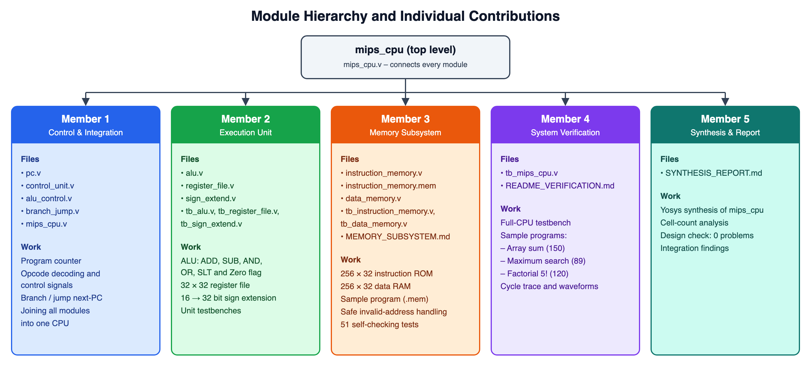
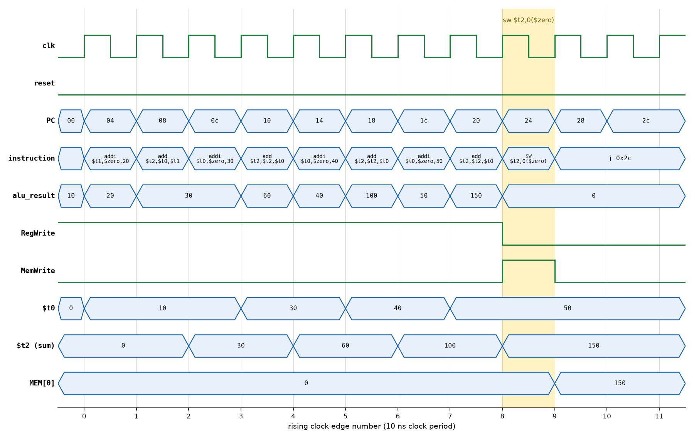
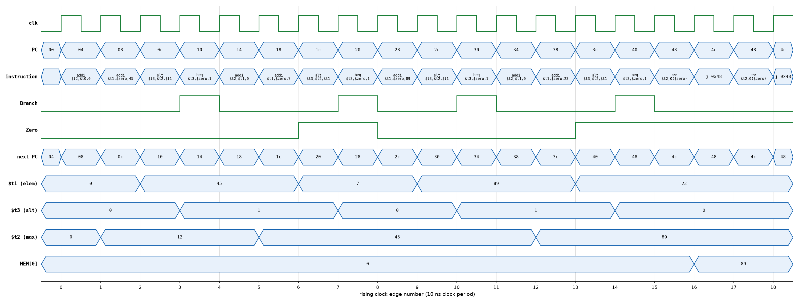
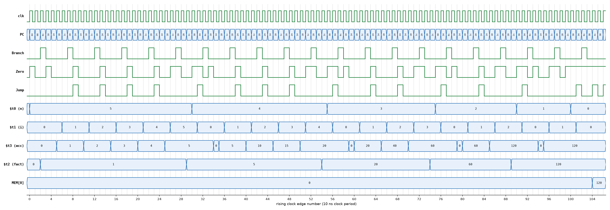
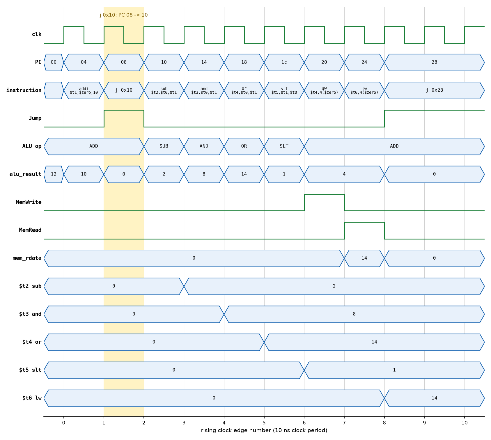
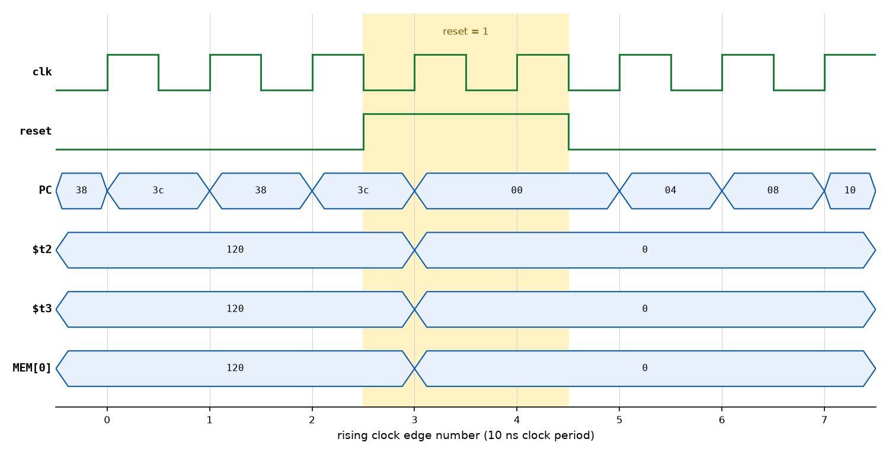
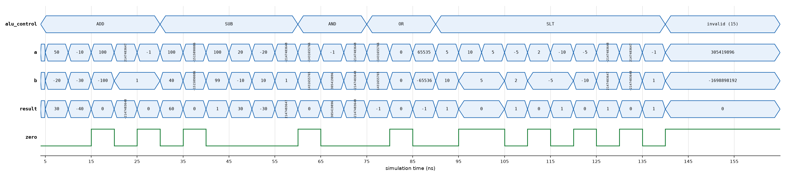

# Single-Cycle 32-bit MIPS Processor with Memory Interface

A 32-bit single-cycle MIPS processor written in Verilog-2001. Every instruction is fetched, decoded, executed and written back in one clock cycle. The processor supports arithmetic, logic, memory and branch/jump instructions. It runs four sample programs: array sum, maximum search, factorial and a jump/logic test.

> 🎥 **Phase I Prototype Demo Video:** [Watch on Google Drive](https://drive.google.com/file/d/14KFQ28BnsEGIQnmpHRSVrq3OwRP9Rdy6/view?usp=sharing)

> 📄 **IEEE Project Report:** LaTeX source in [`report/`](report/)


---

## Features

- **Instruction set:** `add`, `sub`, `and`, `or`, `slt`, `lw`, `sw`, `addi`, `beq`, `j`
- **Datapath:** PC, instruction memory, register file (32 × 32), sign extension, ALU, data memory, branch/jump logic and write-back multiplexer
- **Memories:** 256 × 32-bit instruction ROM and 256 × 32-bit data RAM (1 KB each) with safe handling of invalid addresses
- **Reset:** one active-high synchronous reset clears the PC, all 32 registers and all 256 data-memory words
- **Verification:** self-checking testbenches for every module plus full-CPU program tests and reset checks
- **Performance:** dynamic instruction mix, cycles and CPI measured in simulation and compared with a multi-cycle baseline
- **Synthesis:** Yosys generic, Xilinx Artix-7 and Gowin place-and-route results with maximum frequency (scripts in `synthesis/`)

---

## Repository Structure

```
mca_project/
├── rtl/                    Synthesizable Verilog-2001 RTL (10 modules)
├── tb/                     Self-checking testbenches (7)
├── programs/               Sample program for the instruction ROM ($readmemh)
├── synthesis/              FPGA wrapper, pin constraints, Yosys and Vivado scripts
├── scripts/                plot_waveforms.py (VCD -> PNG waveform figures)
├── docs/
│   ├── diagrams/           Block diagrams (PNG + editable SVG)
│   ├── waveforms/          Simulation waveform screenshots
│   ├── MEMORY_SUBSYSTEM.md
│   ├── VERIFICATION.md
│   ├── SYNTHESIS_REPORT.md
│   └── Project_list_MCA.pdf  Project specification
├── report/                 IEEE report (main.tex, references.bib, PDF)
└── Makefile                Simulation targets
```

| Module | File | Description |
|---|---|---|
| Top level | `rtl/mips_cpu.v` | Connects all modules into the single-cycle CPU |
| Program Counter | `rtl/pc.v` | 32-bit PC register with synchronous reset |
| Control Unit | `rtl/control_unit.v` | Decodes the opcode into control signals |
| ALU Control | `rtl/alu_control.v` | Chooses the ALU operation from ALUOp and funct |
| Branch / Jump | `rtl/branch_jump.v` | Calculates PC+4, branch target and jump target |
| Register File | `rtl/register_file.v` | 32 registers, two read ports and one write port |
| Sign Extension | `rtl/sign_extend.v` | Extends a 16-bit immediate to 32 bits |
| ALU | `rtl/alu.v` | ADD, SUB, AND, OR, SLT and Zero flag |
| Instruction Memory | `rtl/instruction_memory.v` | 256 × 32 ROM loaded from `programs/instruction_memory.mem` |
| Data Memory | `rtl/data_memory.v` | 256 × 32 RAM used by `lw` and `sw` |

| Testbench | What it checks |
|---|---|
| `tb/tb_alu.v` | All ALU operations, Zero flag, signed SLT, overflow |
| `tb/tb_register_file.v` | Reads, writes, reset, `$zero` protection |
| `tb/tb_sign_extend.v` | Positive and negative immediates |
| `tb/tb_instruction_memory.v` | Fetching, program loading, invalid and unaligned addresses |
| `tb/tb_data_memory.v` | Read/write, reset, invalid addresses, read and write in the same cycle |
| `tb/tb_mips_cpu.v` | Full CPU running array sum, maximum search, factorial and a jump/logic test; checks reset |
| `tb/tb_performance.v` | Instruction mix, cycles and CPI for every program; single-cycle vs multi-cycle comparison |

Documents: [Memory subsystem](docs/MEMORY_SUBSYSTEM.md) · [Verification](docs/VERIFICATION.md) · [Synthesis report](docs/SYNTHESIS_REPORT.md)

---

## Team and Individual Contributions

| Member | Area | Main files |
|---|---|---|
| Gauri Jindal | Control Unit & Processor Integration | `pc.v`, `control_unit.v`, `alu_control.v`, `branch_jump.v`, `mips_cpu.v` |
| Sanchit Garg | Execution Unit | `alu.v`, `register_file.v`, `sign_extend.v` and their testbenches |
| Manas Saxena | Memory Subsystem, integration fixes, performance, synthesis flow, waveforms, report | `instruction_memory.v`, `data_memory.v`, `instruction_memory.mem`, their testbenches, `tb_performance.v`, `synthesis/`, `scripts/`, `report/` |
| Tanish Garg | System Verification & Synthesis | `tb_mips_cpu.v`, `docs/VERIFICATION.md`, `docs/SYNTHESIS_REPORT.md` |



---

## How to Run

Requirement: [Icarus Verilog](https://steveicarus.github.io/iverilog/) (`brew install icarus-verilog` on macOS, `sudo apt install iverilog` on Ubuntu). Run from the repository root.

```bash
make all      # run every testbench
make cpu      # full CPU: array sum, maximum, factorial, jump/logic test, reset checks
make perf     # cycles, CPI and multi-cycle comparison
```

Single modules: `make alu`, `make rf`, `make se`, `make imem`, `make dmem`. Each testbench prints `[PASS]` / `[FAIL]` for every check and a final summary. VCD waveforms are written to `sim/` and can be opened in GTKWave.

**Waveform figures:** `pip install vcdvcd matplotlib && python3 scripts/plot_waveforms.py` (after `make all`) regenerates `docs/waveforms/`.

**Synthesis:** `sh synthesis/run_yosys.sh` (Yosys + nextpnr) or `vivado -mode batch -source synthesis/vivado_build.tcl` (Basys3).

---

## Results

| Testbench | Checks passed |
|---|---|
| ALU | 29 / 29 |
| Register File | 20 / 20 |
| Sign Extension | 11 / 11 |
| Instruction Memory | 21 / 21 |
| Data Memory | 30 / 30 |
| Full CPU (4 programs + reset) | 18 / 18 |
| Performance runs | 4 / 4 programs correct |

| Program | Expected result | Result |
|---|---|---|
| Array sum of [10, 20, 30, 40, 50] | 150 | 150 ✔ |
| Maximum of [12, 45, 7, 89, 23] | 89 | 89 ✔ |
| Factorial 5! | 120 | 120 ✔ |
| Jump/logic test (J skips an `addi`, then SUB/AND/OR/SLT/SW/LW) | 2, 8, 14, 1, 14, 14 | all ✔ |

### Performance

Measured with `tb_performance.v` (each program runs until its halt loop; the halt jump is not counted). The single-cycle CPU always has **CPI = 1**. The multi-cycle column uses the classic multi-cycle MIPS step counts (R-type 4, ADDI 4, LW 5, SW 4, BEQ 3, J 3). Times use the textbook component delays (memory 200 ps, register read 100 ps, ALU 200 ps, register write 100 ps), which give an 800 ps single-cycle clock and a 200 ps multi-cycle clock.

| Program | Instructions | Single-cycle cycles | Multi-cycle cycles | Multi-cycle CPI | Single-cycle time | Multi-cycle time |
|---|---:|---:|---:|---:|---:|---:|
| Array sum | 11 | 11 | 43 | 3.90 | 8.8 ns | 8.6 ns |
| Maximum search | 17 | 17 | 64 | 3.76 | 13.6 ns | 12.8 ns |
| Factorial 5! | 105 | 105 | 384 | 3.65 | 84.0 ns | 76.8 ns |
| Jump/logic test | 9 | 9 | 36 | 4.00 | 7.2 ns | 7.2 ns |
| **Total** | **142** | **142** | **527** | **3.71** | **113.6 ns** | **105.4 ns** |

The single-cycle design needs 3.7x fewer cycles, but every cycle must be long enough for the slowest instruction (LW). With these delays the multi-cycle baseline takes about 7% less total time (105.4 ns vs 113.6 ns), because most instructions are R-type, ADDI and BEQ, which finish in 3-4 short steps.

### Synthesis

Yosys generic 22,625 cells (0 problems); Xilinx Artix-7 estimate 4,190 LUTs and 9,216 flip-flops (about 20 % of a Basys3). Details in [docs/SYNTHESIS_REPORT.md](docs/SYNTHESIS_REPORT.md).

### Waveforms

Generated from the simulation VCD files by `scripts/plot_waveforms.py`.

| Figure | What it shows |
|---|---|
|  | **Array sum:** `$t2` accumulates 30 → 60 → 100 → 150; at PC 0x24 `sw` asserts MemWrite and MEM[0] becomes 150 |
|  | **Maximum search:** `beq` is taken when `slt` gives 0, so the update is skipped; the maximum becomes 89 |
|  | **Factorial 5!:** loop counters, branches and jumps; `$t2` = 1, 5, 20, 60, 120 |
|  | **Jump/logic test:** `j` at 0x08 jumps to 0x10 and skips 0x0C; SUB/AND/OR/SLT results; SW/LW at address 4 |
|  | **Reset:** one reset pulse clears the PC, registers and data memory |
|  | **ALU testbench:** ADD, SUB, AND, OR, signed SLT and the Zero flag |

---

## Diagrams

| Diagram | File |
|---|---|
| Datapath and control | [01_datapath.png](docs/diagrams/01_datapath.png) |
| Module hierarchy and contributions | [02_team_modules.png](docs/diagrams/02_team_modules.png) |
| Instruction formats | [03_instruction_formats.png](docs/diagrams/03_instruction_formats.png) |
| Single-cycle execution flow | [04_execution_flow.png](docs/diagrams/04_execution_flow.png) |
| Control signal truth table | [05_control_signals.png](docs/diagrams/05_control_signals.png) |
| Memory subsystem | [06_memory_subsystem.png](docs/diagrams/06_memory_subsystem.png) |
| Verification and synthesis flow | [07_verification_flow.png](docs/diagrams/07_verification_flow.png) |

Editable SVG versions of every diagram are in the same folder.

---

## Project Deliverables

- **Project report (IEEE format):** LaTeX source: [report/main.tex](report/main.tex)
- **Prototype video:** [Google Drive - Phase I Prototype Demonstration Video](https://drive.google.com/file/d/14KFQ28BnsEGIQnmpHRSVrq3OwRP9Rdy6/view?usp=sharing)
- **Project specification:** [docs/Project_list_MCA.pdf](docs/Project_list_MCA.pdf) (Project 2)
